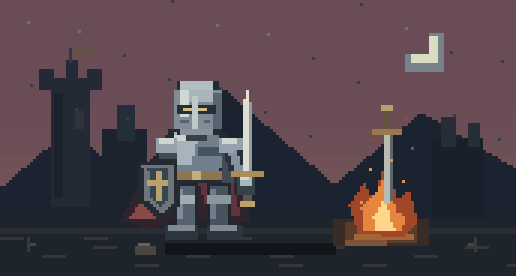
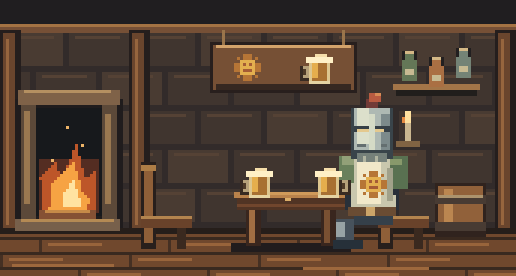

# Soul Revive 1.3 — Pixel Bonfire Desktop Companion

A small Windows, macOS, and Linux work and break companion with an original pixel knight, a bonfire, a changing sky, a cozy tavern, and an offline soundscape. Available in Türkçe and English.

## Animation previews

### Dawn to night — accelerated

A work round's dawn, daylight, sunset, and night compressed into a **22-second loop**. In the app, the sky follows your chosen work duration.



### Chill mode — a toast with Solaire

The knight enters the tavern, joins Solaire, and shares a toast. Both characters take turns sipping in this **20-second loop**.



These GIFs are rendered from the application's current pixel animation code. Run `./export-readme-gifs.ps1` to regenerate them after animation changes.

## Install

Releases are available for Windows, macOS, and Linux on [Releases](https://github.com/emircakil/soul-revive/releases):

### Windows
Download **SoulRevive-Setup.exe**, open it, and select **Kur ve başlat / Install and launch**. No Git, PowerShell commands, development tools, or administrator privileges are needed by users. Setup offers desktop and Windows startup shortcuts and adds the app to Windows Installed Apps. Setup installs to `%LOCALAPPDATA%\SoulsRevive`. For portable use, run **SoulsRevive.exe** directly.

### Linux (x64)
Download **soul-revive-linux-x64.tar.gz**, extract it, and run:
```bash
chmod +x SoulsRevive
./SoulsRevive
```
Includes a `soulrevive.desktop` launcher and icon for easy desktop integration. Settings and statistics are stored in `~/.local/share/SoulsRevive`.

### macOS (Apple Silicon & Intel)
- **Apple Silicon (M1/M2/M3/M4):** download **soul-revive-macos-arm64.tar.gz**
- **Intel Mac:** download **soul-revive-macos-x64.tar.gz**

Extract the archive and double-click **SoulRevive.app** (or run `./SoulsRevive` from Terminal).
If Gatekeeper prompts on first open, run:
```bash
xattr -cr SoulRevive.app
```
Settings and statistics are saved to `~/Library/Application Support/SoulsRevive`.

## Your bonfire

- **Çalışıyorum / Working:** every work round begins at dawn, moves through daylight and sunset, and ends after dark. The default round is 30 minutes, followed by a 3-minute break. Choose work durations of 1–180 minutes and breaks of 1–30 minutes in Settings.
- During active work, the knight randomly sharpens his sword, holds a map still and scans it with his head, or walks toward the bonfire to toss a log. The shield is quickly stowed before handling props; tiny sparks scatter at the sharpening contact point, sharpening stops before the sword rises, and tossed logs follow an independent arc. Each routine lasts 14 seconds, with 10–20 seconds of quiet idle between routines. Pausing freezes the routine; break and mode changes reset it. Sword grips and props share the hands’ pose coordinates.
- **Mola ver / Take a break:** your knight lies down beside the fire and sleeps, with breathing and floating Z animations. Stand up, walk, or stretch while the timer runs. Completing a break restores health and starts a new dawn. Returning early starts a fresh work round without awarding a completed break.
- **Çalışmıyorum / Chill mode:** your knight enters a cozy pixel tavern and sits down with Solaire of Astora. They clink tankards, take turns sipping, and relax by the hearth. The tavern keeps its warm evening lighting regardless of the computer's time; a **Şerefe! / Cheers!** greeting replaces the clock. The work timer and work statistics stop. Returning to Working starts a new round at dawn.
- **Duraklat / Pause:** freezes the timer and work statistics. Screen lock, sleep, or a long timer gap also pauses work. Resume manually when you return.
- Drag the window to move it. The title-bar **gear button** opens Settings. **_ / X** hide it to the tray; the timer continues. Double-click the tray bonfire to reveal it, or right-click and choose **Çıkış / Quit** to exit.

## Settings and statistics

**Genel / General:** choose Türkçe or English, Dark mode or Lit mode, timer durations, always-on-top, reminder sounds, and Windows startup. The pixel font is embedded, including Turkish characters; no font installation is needed. Changing durations starts a new round. Other settings preserve your timer.

**Sesler / Sounds:** enable **Müzik ve ortam seslerini çal / Play music and ambience**, set independent **Fire**, **Ambience**, and **Music** volumes from 0–100%, then select Save for continuous background playback. Fire crackle, wind, and the bonfire melody mix together. Preview and stop audio before saving. Preview and reminder sounds use independent playback, and saved audio preferences apply again at launch. All layers are synthesized locally and work offline. Reminder sounds have their own checkbox. Soundscape playback starts disabled until enabled here.

**İstatistikler / Statistics:** shows lifetime work hours, today's work hours, completed work rounds, and today's completed breaks and movement minutes. The main window displays today's and lifetime work in hours, minutes and seconds; the statistics dialog refreshes while open. Today's total rolls over at midnight, and lifetime hours keep accumulating across restarts and updates. Only active timer seconds count as work; pauses, breaks, chill, time after expiry, and time while the app is closed are excluded. Lifetime tracking starts with version 1.1; older versions did not record work hours.

Data is saved locally every 5 seconds and on state changes, closing the window or exit to `%LOCALAPPDATA%\SoulsRevive\settings.json`. Work totals are also stored independently in `statistics.json`. Both files use atomic backups, and older settings automatically migrate existing hours. Statistics recover independently if settings become damaged. In-app updates retain the active profile and its work history. The app uses no camera or movement detection. Uninstall through Windows Installed Apps; settings and work history are retained for reinstalling.

## Knight equipment

Open **Settings > Knight** to choose armor (Steel knight, Black knight, Golden guardian), sword (Longsword, Broadsword, Estoc), and shield (Cross shield, Round shield, Blue guardian). Each choice is independent and has an immediate equipment preview. Save equips and remembers your choices; Cancel preserves your current gear. Armor carries into work, rest, and tavern scenes, and weapons follow the existing hand and shield-stowing animation anchors. The developer panel uses the equipped appearance.

## Developer animation panel

Press **F8** in the main window, or open **Settings > General > Developer panel**. Select idle, sharpening, map reading, log throwing, sleep, or the tavern. The panel offers a 4x pixel preview, play/pause, previous/next frame, a draggable timeline, restart, 0.5x/1x/2x speed, and day/dawn/night lighting (the tavern retains its own lighting). Escape closes the panel. Preview controls use independent state and do not change your work mode, timer, or statistics.

Sharpening emits a few single-pixel sparks at the blade contact point. During map reading, both hands hold the paper still while the helmet scans left and right.

## In-app updates

Open **Ayarlar > Güncelleme / Settings > Updates**, check for updates, then select **İndir ve güncelle / Download and update** and approve the restart. The app fetches the latest stable GitHub Release, verifies its SHA-256 digest, file size, and assembly version, saves your session, atomically replaces the executable, keeps a rollback copy, and restarts. It never fetches source or runs a build on the user's machine. Failed downloads leave the running version intact.

The release must contain an asset named **SoulsRevive.exe** with a GitHub-provided SHA-256 digest. Drafts, prereleases, and older versions are excluded. Offline, rate-limited, missing-release, and incomplete-release states are displayed in the panel. Until the first GitHub Release is published, the app reports that no release is available.

## Build and verify

Develop on Windows with .NET Framework 4.8 or later and .NET 9 SDK.

```powershell
.\build.ps1
.\verify.ps1
.\build-cross.ps1
```

The Windows native build generates a multi-resolution pixel bonfire icon, embeds the VT323 font, and produces:

- `bin\SoulsRevive.exe` — Windows portable application
- `bin\SoulRevive-Setup.exe` — Windows standalone graphical installer
- `bin\soul-revive-linux-x64.tar.gz` — Linux x64 package with desktop launcher
- `bin\soul-revive-macos-arm64.tar.gz` — macOS Apple Silicon (M1/M2/M3/M4) `.app` bundle & binary
- `bin\soul-revive-macos-x64.tar.gz` — macOS Intel `.app` bundle & binary
- `bin\SHA256SUMS.txt` — checksums for all packages

`verify.ps1` checks timer transitions, work statistics, midnight rollover, legacy settings migration, backup recovery, localization, sound layers, release validation, and tamper rejection. It also checks the tavern arrival, toast and sipping poses, Solaire's sun crest, and scene independence from local time. It renders all major views in both themes and languages to `test-output`. It also verifies installer extraction and upgrades in an isolated folder and runs the real update helper against disposable fixture executables to test its readiness handshake, replacement, rollback copy, and restart. Your installed app, registry, and real statistics are untouched by these checks.

To launch setup from a source checkout, run `./install.ps1`. For an isolated UI development profile, run `bin\SoulsRevive.exe --profile "C:\full\path\profile"`.

## Publish a release

1. Update `AssemblyVersion` and `AssemblyFileVersion` in `src/Experience.cs`.
2. Run build and verification, commit changes, then push a matching tag such as `v1.3.0`.
3. `.github/workflows/release.yml` builds, verifies, checks the tag against the embedded version, and publishes Windows, macOS, and Linux packages with checksums to GitHub Releases. Future users can update entirely inside the app.

Regular CI also builds and verifies all packages and uploads UI previews. Release publishing is a maintainer action; building locally does not publish anything.

## Artwork and font

The scene, knight poses, tavern sprites (including the fan depiction of Solaire of Astora), UI ornamentation, bonfire icon, and synthesized audio are drawn or generated for this project. The embedded [VT323](https://fonts.google.com/specimen/VT323) font by Peter Hull is distributed under the SIL Open Font License 1.1; its license and source reference are in `assets/fonts` and embedded in both executables.

This is an independent fan project with no official Dark Souls assets or recordings.
